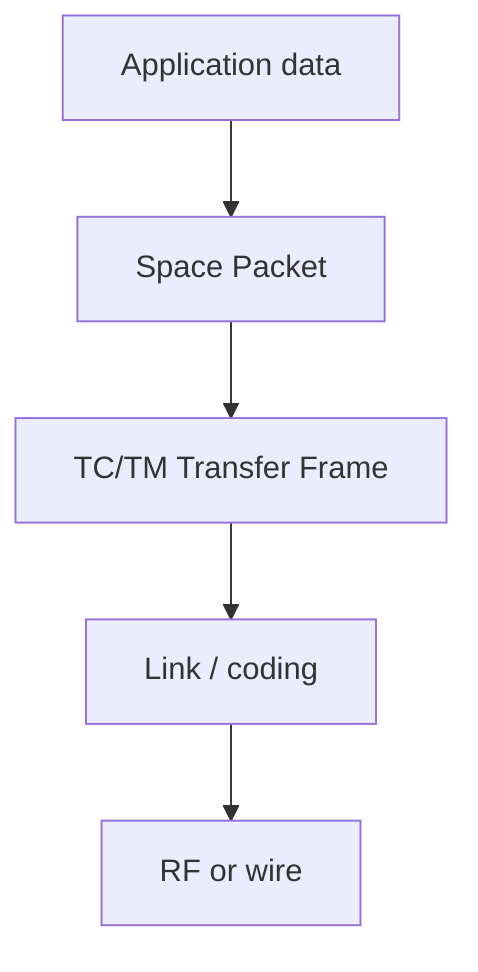

# CCSDS & SpaceWire

::: tip Why this matters
Flight software talks to the ground and to other spacecraft units over standardized protocols. CCSDS defines the packet and telemetry/telecommand layers; SpaceWire defines a high-speed link and routing layer. You do not need to implement the standards from scratch, but you need to parse, validate, route, and test them.
:::

## Learning objectives

- Describe the CCSDS Space Packet primary header and APID routing.
- Explain TC/TM transfer frames, virtual channels, and COP-1.
- Explain SpaceWire links, routers, packets, RMAP, and time distribution.
- Parse a packet safely: length, sequence, checksum, endianness.
- Design a command/telemetry interface and test it with loopback and fault injection.

## The CCSDS stack



- **Space Packet Protocol** — the end-to-end packet format.
- **TC Space Data Link Protocol** — telecommands.
- **TM Space Data Link Protocol** — telemetry.
- **AOS** — advanced orbiting systems, high-rate telemetry.
- **COP-1** — command link reliability (retransmission).
- **SDLS** — space data link security.
- **CFDP** — file delivery.
- **SpaceWire** — the onboard link and routing standard.

## The Space Packet header

A CCSDS Space Packet has a 6-byte primary header:

| Field | Bits | Meaning |
| --- | --- | --- |
| Version | 3 | Usually 0 |
| Type | 1 | 0 = telemetry, 1 = telecommand |
| Secondary header flag | 1 | 0 = absent, 1 = present |
| APID | 11 | Application Process Identifier |
| Sequence flags | 2 | 00 = continuation, 01 = first, 10 = last, 11 = standalone |
| Sequence count | 14 | Per-APID counter |
| Packet data length | 16 | Number of bytes after the header, minus 1 |

The APID is the routing key. The flight software typically has a dispatch table:

```c
switch (apid) {
    case APID_NAV:    handle_nav(packet); break;
    case APID_GUID:   handle_guidance(packet); break;
    case APID_HK:     handle_housekeeping(packet); break;
    default:          reject_unknown_apid(apid); break;
}
```

Validate before dispatch:

- packet length matches the header,
- APID is known and enabled,
- sequence count is plausible,
- checksum (if present) is correct,
- timestamp is valid,
- payload length matches the expected structure,
- values are in range.

A parser that trusts the length field is a remote crash primitive.

## TC and TM frames

A TC Transfer Frame typically has:

- a 5-byte primary header (version, bypass, control, spacecraft ID, virtual channel ID, frame count, frame length),
- a data field (often a Space Packet),
- a 2-byte frame error control field (FECF).

A TM Transfer Frame typically has:

- a 6-byte primary header (version, spacecraft ID, virtual channel ID, operational control field flag, master channel frame count, virtual channel frame count, first header pointer),
- an optional secondary header,
- a data field,
- an optional FECF.

Virtual channels let you separate traffic classes (housekeeping, science, events) with different rates and priorities. A virtual channel can be lossy or reliable depending on the protocol.

## COP-1

COP-1 (Communications Operation Procedure-1) provides reliable command delivery:

- commands are sent in frames with a sequence count,
- the receiver acknowledges with a report,
- the sender retransmits unacknowledged frames,
- **AD** frames are available for immediate execution,
- **BD** frames wait for a retransmission request.

The details matter for timing and for “why did the command execute twice?” Test the retransmission path, not just the nominal path.

## SpaceWire

SpaceWire is a point-to-point, full-duplex serial link with routers. Key concepts:

- **Link:** two endpoints, with flow control and error detection.
- **Packet:** destination address, cargo, end-of-packet marker.
- **Router:** forwards packets by path address.
- **RMAP:** remote memory access protocol for reads/writes.
- **Time codes:** distribute a coarse time reference.
- **Redundancy:** dual links, hot/cold sparing.

SpaceWire is common for high-rate instruments and payloads. SpaceFibre is a newer, faster link with quality-of-service features. For flight software, you need to know how to configure the link, handle errors, and test the packet path.

## A packet parser in C++

```cpp
struct PacketView {
    std::uint16_t apid;
    std::uint16_t sequence;
    const std::uint8_t* payload;
    std::size_t payload_len;
};

bool parse_space_packet(const std::uint8_t* data, std::size_t len, PacketView& out) {
    if (len < 6) return false;
    const std::uint16_t word0 = (std::uint16_t(data[0]) << 8) | data[1];
    const std::uint16_t word1 = (std::uint16_t(data[2]) << 8) | data[3];
    const std::uint16_t word2 = (std::uint16_t(data[4]) << 8) | data[5];

    const std::uint16_t apid = word0 & 0x07FF;
    const std::uint16_t seq = word1 & 0x3FFF;
    const std::size_t payload_len = word2 + 1;

    if (len != 6 + payload_len) return false;

    out = {apid, seq, data + 6, payload_len};
    return true;
}
```

This is a starting point. Add version/type checks, secondary-header handling, checksum, and bounds on the payload length before allocating anything.

## Testing the interface

- **Loopback:** send a packet, receive it, compare bytes.
- **Golden packets:** known-good hex dumps with expected fields.
- **Malformed packets:** short, long, wrong APID, bad checksum, wrong endianness.
- **Sequence gaps:** drop a packet and verify the handler.
- **Timeout:** no response within the deadline.
- **Rate limit:** burst traffic and queue pressure.
- **Fault injection:** corrupt a byte, flip a bit, truncate a frame.

A protocol test that only sends valid packets is not a protocol test.

## Practice

1. Write a CCSDS Space Packet parser and encoder. Test with golden packets.
2. Add an APID dispatch table and a command handler.
3. Simulate a dropped sequence number and a bad checksum. Verify the response.
4. Capture a UDP or serial stream and decode it with a small Python script.
5. If you have SpaceWire hardware, loop back a packet between two links. If not, write a router simulation.

<Quiz
  question="Which field is the primary routing key for a CCSDS Space Packet?"
  options="The sequence count|The APID|The packet data length|The version number"
  answer="1"
  explanation="The APID identifies the application process. Sequence count detects gaps/reordering; length is validation; version is format."
/>

## Resources

- [CCSDS Space Packet Protocol](https://public.ccsds.org/Pubs/133x0b2e.pdf) — the standard.
- [CCSDS TC Space Data Link Protocol](https://public.ccsds.org/) — telecommand framing.
- [CCSDS TM Space Data Link Protocol](https://public.ccsds.org/) — telemetry framing.
- [SpaceWire](https://www.spacewire.esa.int/) — ESA’s SpaceWire resources and standards.
- [NASA cFS CFDP](https://github.com/nasa/CF) — a flight implementation of file delivery.

Next: [NPR 7150.2 & software assurance](./npr-7150.md).
