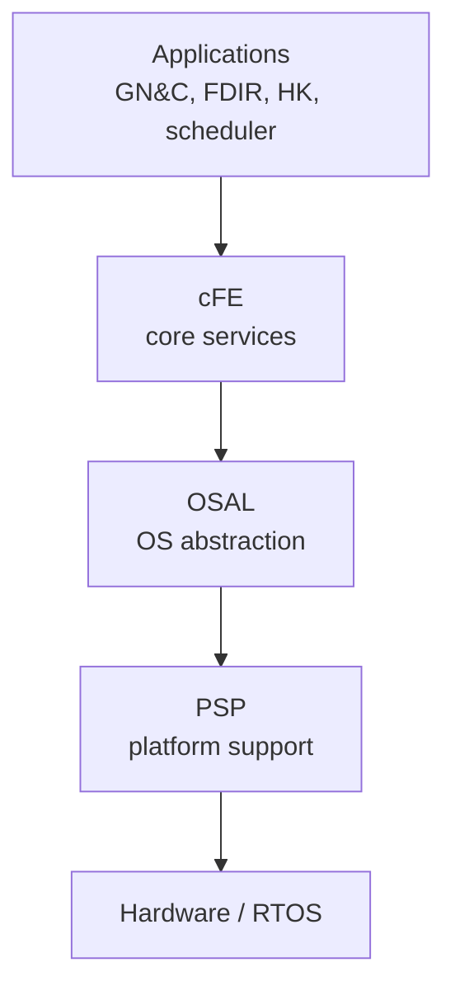

# NASA cFS

::: tip Why this matters
The Core Flight System (cFS) is a reusable, open-source flight software framework used on NASA missions and referenced across the lunar-lander job market. Even if a commercial lander uses a different stack, cFS teaches the architecture vocabulary: software bus, apps, events, tables, health and safety, and a scheduler. Learn it by building a small app.
:::

## Learning objectives

- Describe the cFE, OSAL, PSP, and app layers.
- Explain the Software Bus, Executive Services, Event Services, and Table Services.
- Write the skeleton of a cFS app with commands, telemetry, and events.
- Build and run a cFS target.
- Map cFS concepts to a generic flight architecture.

## The layers



- **cFE (core Flight Executive):** the core services and app framework.
- **OSAL (Operating System Abstraction Layer):** portable APIs for tasks, queues, time, files, and memory.
- **PSP (Platform Support Package):** board-specific support.
- **Apps:** mission-specific software built on the framework.
- **Mission configuration:** message IDs, table definitions, startup scripts, and platform config.

cFS is not an RTOS. It runs on top of an RTOS or a bare-metal/RTEMS/VxWorks/Linux platform.

## The services you will use

| Service | What it does |
| --- | --- |
| **Software Bus (SB)** | Publish/subscribe message routing between apps |
| **Executive Services (ES)** | App startup, run loop, task management, reset |
| **Event Services (EVS)** | Structured events and telemetry |
| **Table Services (TBL)** | Loadable configuration tables with validation |
| **Health & Safety (HS)** | Watchdog, CPU/memory monitoring, app monitoring |
| **Scheduler (SCH)** | Time-driven command and rate-group scheduling |
| **Stored Command (SC)** | Timed command sequences |
| **Housekeeping (HK)** | Telemetry collection |
| **Limit Checker (LC)** | Limit monitoring and fault response |
| **Memory Manager (MM)** | Memory load/dump |
| **Memory Dwell (MD)** | Periodic memory telemetry |
| **Checksum (CS)** | Memory/image checksums |
| **File Manager (FM)** | File operations |
| **Data Storage (DS)** | Store-and-forward telemetry |
| **CFDP (CF)** | File delivery protocol |
| **Command Ingest (CI)** | Ground command interface |
| **Telemetry Output (TO)** | Downlink interface |

The exact set depends on the cFS release and mission configuration. The concepts are stable.

## The app pattern

A cFS app is a task with:

- an initialization function,
- a software bus pipe,
- subscribed messages,
- a command dispatch table,
- a housekeeping telemetry message,
- optional tables,
- a run loop that processes messages until exit.

Pseudo-code:

```c
void APP_Main(void) {
    CFE_Status_t status = APP_Init();
    if (status != CFE_SUCCESS) {
        CFE_ES_WriteToSysLog("APP init failed: 0x%08X", status);
        return;
    }

    while (CFE_ES_RunLoop(&APP_RunStatus) == true) {
        CFE_SB_ReceiveBuffer(&BufPtr, APP_CmdPipe, CFE_SB_PEND_FOREVER);
        APP_ProcessCommand(BufPtr);
        CFE_SB_ReleaseBuffer(BufPtr);
        APP_SendHousekeeping();
    }

    APP_Cleanup();
}
```

The run loop is usually more structured: process commands, run the rate-group function, send telemetry, and check for exit. The scheduler can call a rate-group function instead of a blocking receive.

## Commands, telemetry, and events

A command message has:

- a message ID (MID),
- a command code,
- arguments,
- a checksum/validation path.

A telemetry message has:

- a MID,
- a timestamp,
- a sequence count,
- the payload.

An event has:

- an event ID,
- a severity,
- a message string,
- context data.

Use events for faults and state changes. Use telemetry for continuous state. Do not put a critical fault only in a log message.

## Tables

Tables are loadable configuration:

- controller gains,
- mode thresholds,
- FDIR limits,
- filter parameters,
- timing constants.

A table load must be validated before it is applied. A bad gain table can destabilize the vehicle. The table service provides a validation hook; use it.

## Build and run

The cFS build is typically:

1. clone cFS, cFE, OSAL, PSP, and the sample apps,
2. create a mission configuration,
3. define the target and CPU,
4. build with CMake or the classic makefiles,
5. run on Linux for a first test, then on the target,
6. load apps and tables, start the scheduler, and send commands.

The exact commands depend on the release. Read the cFS build documentation for your version. Do not copy a build script from an old tutorial.

## Why cFS matters in an interview

You should be able to say:

- “cFS separates core services from mission apps.”
- “Apps communicate through the Software Bus, not direct calls.”
- “The scheduler drives rate groups; Health & Safety monitors the system.”
- “Tables are loadable and validated; commands are routed by MID.”
- “I built a sample app with a command, telemetry, an event, and a table.”

That is a credible conversation. You do not need to claim you flew a cFS mission.

## Practice

1. Build cFS for Linux using the current release instructions.
2. Run the sample app and send it a command.
3. Add a housekeeping telemetry point and an event.
4. Add a table with a validation hook that rejects an out-of-range gain.
5. Map your descent app’s modules to cFS apps: navigation, guidance, control, FDIR, HK.

<Quiz
  question="What is the cFS Software Bus primarily for?"
  options="Compiling apps|Publish/subscribe message routing between apps|Storing telemetry on disk|Scheduling the CPU"
  answer="1"
  explanation="The Software Bus routes messages between apps using message IDs. It decouples producers and consumers; scheduling is handled by the scheduler/executive, and storage by data storage/file services."
/>

## Resources

- [NASA cFS](https://github.com/nasa/cFS) — source and releases.
- [cFS documentation](https://nasa.github.io/cFS/) — architecture, build, and app development.
- [cFE documentation](https://github.com/nasa/cFE) — core services.
- [OSAL](https://github.com/nasa/osal) — OS abstraction.
- [cFS sample apps](https://github.com/nasa/cFS/tree/main/apps) — the fastest way to learn the pattern.

Next: [FreeRTOS, VxWorks & RTEMS](./rtos.md).
