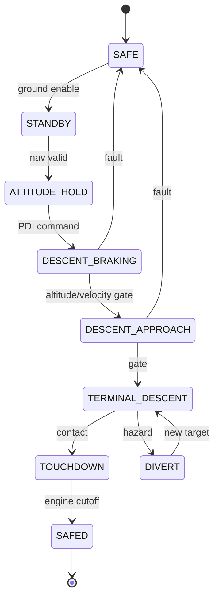

# Fault protection & mode logic

::: tip Why this matters
A lunar lander is a one-shot system. There is no hangar, no rescue, and often no second attempt. Fault protection is not a feature you add at the end; it is the architecture that decides what the vehicle does when a sensor lies, an actuator sticks, or a deadline is missed.
:::

## Learning objectives

- Define fault detection, isolation, and recovery (FDIR).
- Design a mode state machine with guards and priorities.
- Choose detection methods and set thresholds that do not nuisance-trip.
- Design safe mode, abort, and divert behavior.
- Analyze detection latency and recovery time.
- Test fault paths with injection, not just nominal cases.

## FDIR in one page

| Step | Question | Example |
| --- | --- | --- |
| **Detection** | Is something wrong? | IMU sample is 300 ms old |
| **Isolation** | What is wrong? | IMU-A is stale; IMU-B is valid |
| **Recovery** | What do we do? | Switch to IMU-B, log event, continue |
| **Reconfiguration** | What changes? | Nav uses IMU-B; control uses the backup rate |
| **Reporting** | What does the ground see? | Event + telemetry with timestamp |

Detection without isolation can disable the wrong unit. Isolation without recovery leaves the vehicle in a degraded state. Recovery without reporting leaves the ground confused.

## Modes

A descent mode set might be:



Every transition needs:

- a **guard** (conditions, sensor validity, authority),
- an **action** (command, configuration, telemetry),
- a **priority** (fault transitions override nominal),
- a **test**.

Avoid two-authority designs where guidance and FDIR both command the same actuator without arbitration. Define who owns the actuator in each mode.

## Detection methods

| Method | Use | Risk |
| --- | --- | --- |
| **Range/threshold** | Altitude, rate, temperature, voltage | Nuisance trips at the boundary |
| **Rate of change** | Sudden jumps, divergence | Noise sensitivity |
| **Stale data** | Timestamp age | Clock mismatch |
| **Watchdog** | Software hang | Reset loops, lost context |
| **CRC/checksum** | Corrupt memory or packet | Undetected multi-bit errors |
| **Voting** | Redundant sensors/computers | Common-mode failure |
| **Model residual** | Filter innovation, dynamics mismatch | Model error |
| **Sequence gap** | Dropped packets | Reordering vs loss |
| **Limit checking** | Command/telemetry bounds | Wrong limits |

A good detector has a **false-positive rate**, a **detection latency**, and a **coverage** claim. Test all three.

## Thresholds and hysteresis

A threshold with no hysteresis will chatter. Use:

- a trip threshold and a clear threshold,
- a persistence count or time,
- a rate limit,
- a validity window,
- a fault confirmation before reconfiguration.

Example: declare an IMU stale after 3 consecutive samples older than 100 ms, not after one late sample. Clear only after 10 consecutive valid samples. Log both the trip and the clear.

## Safe mode

Safe mode should be a known, tested state:

- safe attitude (often sun-pointing or a thermally safe attitude),
- engine off,
- RCS safe,
- minimum power,
- telemetry on,
- commanding enabled,
- watchdog active,
- fault context preserved.

Safe mode is not “do nothing.” It is a controlled state with a defined power, thermal, and communications posture.

## Abort and divert

For a one-shot landing:

- **Abort to orbit** requires delta-v, time, and a viable orbit.
- **Divert** requires a secondary site and enough fuel/time.
- **Hover** buys time but burns fuel.
- **Continue degraded** is only acceptable if the evidence supports it.

Each option needs a trigger, a time budget, a fuel budget, and a test. Do not assume “abort” is always available.

## One-shot landing constraints

The terminal descent is unforgiving:

- detection latency must be short enough to act,
- recovery may be impossible below a certain altitude,
- a stuck thruster may be unrecoverable,
- a wrong attitude may be worse than a wrong altitude,
- plume/dust can blind sensors,
- contact detection must be robust.

This shifts emphasis to:

- **pre-flight verification** and Monte Carlo,
- **fault tolerance by design** (redundancy, margins),
- **conservative guidance** with reserves,
- **tested fault responses** at the terminal phase,
- **clear authority** between crew/ground and autonomy.

## Fault tree example

Top event: “uncontrolled descent at touchdown.”

```
Uncontrolled descent
├── Navigation fault
│   ├── IMU bias/drift undetected
│   ├── Altimeter stuck
│   └── Frame/time error
├── Guidance fault
│   ├── Infeasible command
│   ├── Mode transition error
│   └── Target error
├── Control fault
│   ├── Actuator saturation
│   ├── Stuck RCS
│   └── Gain/table error
├── FDIR fault
│   ├── Detector missed
│   ├── Wrong isolation
│   └── Recovery too late
└── Environment/model
    ├── Terrain higher than map
    ├── Plume/dust blindness
    └── Gravity/model error
```

For each leaf, define detection, mitigation, and evidence. A fault tree without evidence is a brainstorm.

## Timing

For each fault:

- **detection latency** — how long until the fault is declared,
- **isolation latency** — how long until the failed unit is identified,
- **recovery latency** — how long until the safe/alternate state is active,
- **total time to safe** — compare to the available time.

A fault that is detected in 2 s but leaves only 1 s to recover is not protected.

## Testing faults

- inject one fault at a time,
- inject combinations that could defeat redundancy,
- test at the worst time (terminal descent),
- test the detector’s false-positive rate with noise,
- test recovery transients,
- test the reset/watchdog path,
- test the ground command path,
- log the decision, not just the outcome.

## Practice

1. Draw a mode state machine for your descent sim with at least five modes and three fault transitions.
2. Implement a stale-nav detector with persistence and hysteresis. Test it with noise and a real dropout.
3. Add a redundant IMU and a voting/isolation rule. Inject a bias fault.
4. Write a fault tree for “landing miss > 100 m.” Add one evidence item per leaf.
5. Measure detection-to-safe time for a stuck altimeter at 100 m altitude.

<Quiz
  question="A fault is detected in 2 seconds and recovery takes 3 seconds, but the available time before touchdown is 4 seconds. What is the correct conclusion?"
  options="The fault is protected because it was detected|The total time to safe exceeds the available time, so the response is not adequate|The detector needs a lower threshold|Recovery is optional"
  answer="1"
  explanation="Detection time plus isolation plus recovery must fit inside the available time, with margin. Detecting a fault you cannot recover from in time is not protection."
/>

## Resources

- [NASA Fault Detection, Isolation, and Recovery](https://swehb.nasa.gov/) — software engineering handbook material.
- [NASA Systems Engineering Handbook](https://www.nasa.gov/connect/ebooks/nasa-systems-engineering-handbook/) — fault trees and risk.
- [NPR 7150.2](https://nodis3.gsfc.nasa.gov/displayDir.cfm?t=NPR&c=7150&s=2) — software assurance and safety.
- [cFS Health & Safety](https://github.com/nasa/HS) — a concrete watchdog/monitoring implementation.

Next: [sensors & actuators](./sensors-actuators.md).
