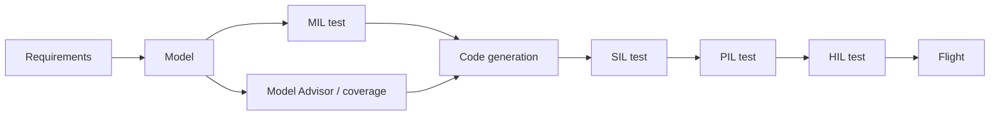

# Simulink → flight code

::: tip Why this matters
Many GNC organizations design in Simulink and generate C for the flight processor. The handoff is where model assumptions meet compiler flags, sample times, data types, and a handwritten application. If you can explain that pipeline, you can integrate with a GNC team instead of just reading their diagrams.
:::

## Learning objectives

- Structure a model for code generation: plant, controller, harness, data dictionary.
- Choose fixed-step, discrete sample times and data types.
- Use model referencing and buses to define interfaces.
- Generate code with Embedded Coder and integrate the generated API.
- Run MIL/SIL/PIL/back-to-back tests.
- Diagnose the common model-to-code mismatches.

## The model-based design flow



The model is not the flight code. It is a specification that a generator translates. The translation has assumptions, and those assumptions are your integration risk.

## Structure the model for generation

A workable split:

```
controller.slx          # the part that becomes flight code
plant.slx               # simulation-only
sensor_model.slx        # simulation-only
test_harness.slx        # MIL/SIL/PIL harness
data/
  controller.sldd       # data dictionary
  params.m              # initialization
```

Use **model references** for the controller so it can be generated and tested independently. Keep simulation-only blocks (scopes, plant dynamics, noise) out of the generated subsystem. Use **variant subsystems** for test vs flight configurations, but verify which variant was built.

## Data dictionary and buses

Interfaces should be explicit:

- define a `Bus` for `NavState`, `GuidanceCmd`, `ActuatorCmd`,
- set units and ranges in the data dictionary,
- define every parameter with a storage class,
- avoid magic numbers in blocks.

A bus is the model equivalent of a message schema. If the bus changes, every consumer changes. That is a feature.

## Sample times and rates

For generated flight code:

- use a **fixed-step discrete** solver,
- set the controller sample time explicitly (e.g., `0.01` s),
- make rate transitions explicit with rate-transition blocks,
- avoid algebraic loops,
- verify that every rate is an integer multiple of the base rate,
- document the task that calls each rate.

A model that runs at a variable step in simulation may generate code that assumes a fixed step. That mismatch is a classic integration bug.

## Data types and fixed point

Flight code often uses `single` or fixed-point types for memory and determinism. If you use floating point:

- confirm the target has an FPU and the compiler flags are correct,
- check NaN/Inf behavior,
- compare host and target results,
- avoid `double` in a memory-constrained loop unless needed.

If you use fixed point:

- choose scaling and word length deliberately,
- check overflow and quantization,
- test at the extremes,
- document the scaling in the data dictionary.

## Embedded Coder

Typical settings:

- system target file: `ert.tlc` (or your program’s target),
- language: C or C++,
- generate a reusable function interface,
- static allocation,
- no dynamic memory,
- code style and naming per the program,
- comments and traceability,
- calibration/measurement support (A2L/ASAP2) if the program uses it,
- report generation.

Generated API (names vary):

```c
void controller_initialize(void);
void controller_step(void);
void controller_terminate(void);

extern Controller_U controller_U;   // inputs
extern Controller_Y controller_Y;   // outputs
```

A handwritten wrapper maps the flight software’s messages to `controller_U`, calls `controller_step()` at the right rate, and copies `controller_Y` to the actuator command. The wrapper is flight code too; it needs tests.

## Integration checklist

- [ ] Generated code compiles with the target compiler and flags.
- [ ] No dynamic allocation in the generated code.
- [ ] All states are initialized before the first step.
- [ ] The step function is called at the model’s sample time.
- [ ] Inputs are validated and range-checked.
- [ ] Outputs are saturated and checked.
- [ ] Units and frames match the interface.
- [ ] The generated code is versioned with the model.
- [ ] The target build is tested, not just the host build.
- [ ] The model and code are traceable to requirements.

## Verification

| Test | What it checks |
| --- | --- |
| **Model Advisor** | Modeling standards and code-generation readiness |
| **MIL** | Algorithm behavior in the model |
| **SIL** | Generated code behavior on the host |
| **PIL** | Generated code on the target processor |
| **Back-to-back** | Model vs code equivalence |
| **Coverage** | Model and code coverage |
| **Requirements link** | Traceability to requirements |

Back-to-back testing is essential. A model that passes MIL and code that compiles is not proof that the generated code implements the same behavior.

## Common failures

1. **Sample-time mismatch.** The model assumes 10 ms; the scheduler calls it at 20 ms.
2. **Algebraic loop.** The generated code has a direct feedthrough path that the target cannot execute in one step.
3. **Data-type mismatch.** `double` in the model, `single` on the target; results diverge.
4. **State initialization.** The generated code starts from zero, but the model started from a trimmed operating point.
5. **Frame/unit mismatch.** The model’s attitude is body-to-inertial; the interface expects inertial-to-body.
6. **Hidden state.** A block with internal state is not reset between runs.
7. **Optimizer differences.** Floating-point reassociation changes a limit case.
8. **Handwritten wrapper bugs.** The generated code is fine; the mapping is wrong.
9. **Version skew.** The model, data dictionary, and generated code are from different commits.
10. **Target library differences.** `sin`, `cos`, or `sqrt` behave differently on the target.

## Practice

1. Build a discrete controller model with a bus input and output. Generate C.
2. Write a handwritten wrapper that calls `initialize` and `step` at 100 Hz.
3. Run a back-to-back test: same inputs to the model and the generated code; compare outputs.
4. Change the sample time to 20 Hz and observe the closed-loop degradation.
5. Introduce a unit mismatch in the wrapper and write a test that catches it.

<Quiz
  question="The model passes MIL and the generated code compiles. What is the most important missing check?"
  options="A prettier block diagram|Back-to-back/SIL comparison of the model and generated code, plus target timing|A larger scope|More comments"
  answer="1"
  explanation="Compilation is not equivalence. Back-to-back or SIL/PIL testing checks that the generated code behaves like the model, and target timing checks that it runs at the required rate."
/>

## Resources

- [MathWorks Embedded Coder](https://www.mathworks.com/products/embedded-coder.html) — code generation and targets.
- [Simulink Test](https://www.mathworks.com/products/simulink-test.html) — MIL/SIL/PIL and baselines.
- [Model Advisor](https://www.mathworks.com/help/simulink/ug/consult-the-model-advisor.html) — modeling standards.
- [DO-331](https://www.rtca.org/) — model-based development and verification guidance (airborne analogue).

Next: [NASA cFS](./cfs.md).
