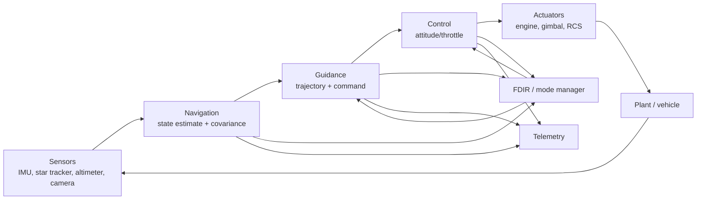

# GNC software architecture & interfaces

::: tip Why this matters
Most GNC failures in integration are not exotic math. They are stale data, a wrong frame, a missing validity flag, a mode transition that raced, or a rate group that missed its deadline. Architecture is how you make those failures visible and testable before flight.
:::

## Learning objectives

- Draw the GNC data flow from sensors to actuators.
- Choose rate groups and justify them with timing budgets.
- Define message contracts with units, frames, timestamps, and validity.
- Design mode logic and fault transitions.
- Separate guidance, navigation, control, and FDIR responsibilities.
- Identify the integration bugs that appear in SIL/HIL.

## The module map



The arrows are messages, not function calls. In a flight architecture, each module should be testable in isolation with recorded inputs.

## Rate groups

A rate group is a set of functions that run at the same frequency. Typical descent rates:

| Function | Typical rate | Why |
| --- | --- | --- |
| IMU sampling | 100–400 Hz | Capture body dynamics and vibration |
| Attitude control | 50–100 Hz | Fast enough for rigid-body modes and actuator limits |
| Navigation update | 10–50 Hz | Sensor fusion and propagation |
| Guidance | 1–10 Hz | Trajectory is slower than attitude |
| Mode/FDIR | 1–10 Hz | Fault detection latency vs processor load |
| Telemetry | 1–10 Hz | Downlink bandwidth |

These are starting points, not requirements. The correct rate comes from the closed-loop bandwidth, the sensor dynamics, the actuator dynamics, and the CPU budget. A 10 Hz controller cannot stabilize a mode at 5 Hz.

### Timing budget

For each rate group, account for:

- sensor read and timestamping,
- navigation propagation,
- guidance computation,
- control computation,
- actuator command write,
- telemetry/logging,
- margin.

If the worst-case execution time plus jitter exceeds the period, the loop is not schedulable. Measure it; do not assume it.

## Data contracts

A message is an interface. Define it like one:

```text
NavState
  timestamp_met_s        double, monotonic
  timestamp_utc          double, for logs
  frame_position         enum (MCI, MCMF, ENU)
  frame_velocity         enum
  position_m[3]          double
  velocity_mps[3]        double
  attitude               quaternion, q_body_from_frame, scalar-first
  attitude_valid         bool
  covariance_diag[15]    double, optional
  sequence               uint32
  checksum               uint16
```

Rules:

- **Units in the name or the schema.** `altitude_m`, not `altitude`.
- **Frame in the name or the schema.** `vel_enu_mps`.
- **Timestamp and time scale.** Monotonic MET for scheduling; UTC for operations.
- **Validity and quality.** A star tracker quaternion without a validity flag is a trap.
- **Sequence and checksum.** Detect drops and corruption.
- **Fixed layout and endianness.** If it goes on a wire, serialize explicitly.
- **Version.** Interfaces change; record the version.

## Modes and transitions

A mode manager is a state machine with guards, actions, and priorities. A descent mode set might be:

```
SAFE → STANDBY → ATTITUDE_HOLD → DESCENT_BRAKING → DESCENT_APPROACH
     → TERMINAL_DESCENT → TOUCHDOWN → SAFED
```

Plus fault modes:

```
ANY → SAFE
ANY → ABORT (if available)
TERMINAL_DESCENT → DIVERT (if hazard detected)
```

Each transition needs:

- a **guard** (conditions, sensor validity, time, authority),
- an **action** (command, configuration, telemetry),
- a **priority** (fault transitions override nominal),
- a **test** (nominal and off-nominal).

Avoid ambiguous states. “Descent” and “safe” at the same time is a design bug. Use a single authoritative mode variable and make transitions atomic.

## FDIR responsibilities

Fault detection, isolation, and recovery should be a separate concern from guidance and control:

- **Detection:** thresholds, rate limits, stale data, watchdogs, checksums, voting, model residuals.
- **Isolation:** identify the failed unit or signal; avoid disabling a healthy redundant unit.
- **Recovery:** retry, reset, switch redundant unit, enter safe mode, abort.
- **Reporting:** event, telemetry, timestamp, and enough context to reconstruct the decision.

A controller should not silently ignore a failed sensor. A mode manager should not depend on a single unvalidated measurement.

## Architecture patterns

| Pattern | Strength | Risk |
| --- | --- | --- |
| **Cyclic executive** | Simple, deterministic, easy to analyze | Poor for asynchronous events, priority inversion avoided by design |
| **RTOS tasks + queues** | Responsive, modular | Priority inversion, jitter, more complex timing analysis |
| **Publish/subscribe** | Loose coupling, testable | Message drops, ordering, backpressure |
| **Layered** | Clear responsibilities | Layer leakage, duplicated state |
| **Data-centric** | One authoritative state | Hidden coupling, stale data |
| **Active/passive redundancy** | Fault tolerance | Switchover transients, synchronization |

cFS uses a publish/subscribe software bus with a cyclic scheduler and apps. An RTOS design might use rate-monotonic tasks with queues. Both can work; the evidence requirements differ.

## Integration bugs you will actually see

1. **Frame mismatch at a module boundary.** Navigation outputs MCMF, guidance expects ENU.
2. **Unit mismatch.** Altitude in km, velocity in m/s, guidance in meters.
3. **Stale data.** Guidance uses a nav state from 500 ms ago during a fast descent.
4. **Missing validity.** A star tracker is in “lost in space” but the quaternion is still propagated.
5. **Timestamp mismatch.** Sensor time is UTC, control time is MET, and the offset is wrong.
6. **Mode race.** Two transitions fire in the same cycle; the last writer wins.
7. **Initialization order.** Control runs before navigation has a valid state.
8. **Double buffering.** The consumer reads the buffer while the producer writes it.
9. **Queue overflow.** A high-rate sensor overruns a low-rate consumer.
10. **Endianness.** The packet looks right in a hex dump but the float is byte-swapped.

Each of these is a test case. Write them down.

## A minimal interface review checklist

- [ ] Every message has a timestamp and a time scale.
- [ ] Every vector has a frame and a unit.
- [ ] Every measurement has a validity/quality flag.
- [ ] Every command has a range check and an acknowledgment.
- [ ] Every mode transition has a guard and a test.
- [ ] Every rate group has a measured worst-case execution time.
- [ ] Every fault has a detection latency, isolation action, and recovery.
- [ ] Every interface change has a version and a compatibility note.

## Practice

1. Draw the data flow for your 6DOF sim. Label each message with rate, frame, units, and timestamp source.
2. Write the interface table for `NavState`, `GuidanceCmd`, and `ActuatorCmd`.
3. Implement a mode manager with `SAFE`, `ATTITUDE_HOLD`, `DESCENT`, and `TOUCHDOWN`. Add a stale-nav fault that forces `SAFE`.
4. Inject a 500 ms nav delay. Does guidance still meet the landing requirement? What changes?
5. Add a queue between a 100 Hz IMU and a 10 Hz guidance module. What is the maximum age of the data? What happens when it overflows?

<Quiz
  question="Guidance receives a nav state with a valid quaternion but `attitude_valid = false`. What is the correct architectural response?"
  options="Use the quaternion anyway; it is numerically valid|Treat the state as invalid, use the last valid state within a bounded age, or enter a defined fault mode|Average it with the previous quaternion|Increase the guidance rate"
  answer="1"
  explanation="Validity is part of the contract. A numerically well-formed quaternion can still be meaningless. The architecture needs a bounded fallback and an explicit fault response."
/>

## Resources

- [NASA cFS documentation](https://nasa.github.io/cFS/) — a concrete publish/subscribe flight architecture.
- [NASA Systems Engineering Handbook](https://www.nasa.gov/connect/ebooks/nasa-systems-engineering-handbook/) — interfaces, requirements, and verification.
- [NPR 7150.2](https://nodis3.gsfc.nasa.gov/displayDir.cfm?t=NPR&c=7150&s=2) — software lifecycle and assurance requirements.
- [CCSDS Space Packet Protocol](https://ccsds.org/) — the wire format behind many space interfaces.

Next: [V&V for flight software](../test/verification.md).
