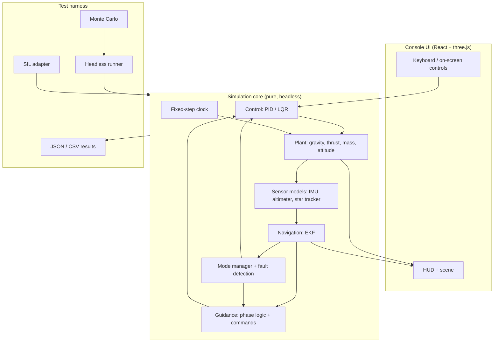

# Bridge to the LLV PDI console

::: tip Why this matters
You already have something most candidates do not: a working lunar-lander interface with a pure simulation seam. The fastest way to convert this guide into skill is to stop treating the console as a demo and start treating it as the **plant and harness** for the topics you are studying. Every month should leave the console measurably more capable, with a test that proves it.
:::

## What you have

The LLV PDI Console is an Electron shell around a React 19 + three.js powered-descent trainer. The interesting part for this guide is small and well isolated:

| File | What it owns |
| --- | --- |
| `src/renderer/src/sim/vehicle.ts` | State shape, initial conditions, phase table, and the pure `stepState(state, dt, controls)` function |
| `src/renderer/src/sim/useVehicle.ts` | Keyboard input, the animation-frame loop, HUD throttling, autosave |
| `src/renderer/src/sim/persistence.ts` | Save/load/reset of mission state in `localStorage` |
| `src/renderer/src/components/` | HUD, scene, mission profile, health status, controls |
| `src/main/index.ts` | Window, `app://` protocol, smoke test |

The seam is the important design decision:

```ts
export function stepState(
  state: VehicleState,
  dt: number,
  controls: Controls
): VehicleState
```

It is pure: same input, same output, no hidden clocks, no rendering. That means you can run it headless, in a test, in a Monte Carlo loop, or behind a different adapter without touching the UI. Protect that property.

The current state includes position, velocity, quaternion, throttle, fuel, phase index and remaining time, target, and display flags. The current `stepState` does four things:

- ramps throttle from held keys,
- rotates the body about one axis with RCS input,
- advances the phase timer and burns fuel,
- returns a new state.

::: warning Be honest about the current model
The console is a **training console**, not yet a physics simulation. It does not integrate translation, apply gravity, compute thrust force, track mass, model sensors, estimate state, or generate guidance commands. Phases advance on a timer, not on state. `phaseIndex` is a scripted sequence, not a mode manager.

That is not a criticism. It is a clean starting point, and the gap between it and a 6DOF sim is exactly the curriculum in this guide.
:::

## The gap, in one table

| Capability | Current console | Target |
| --- | --- | --- |
| Translation | None (position fixed) | Gravity + thrust + RCS, fixed-step integration |
| Rotation | Single-axis pitch from keys | Full 3-axis rigid-body dynamics with inertia |
| Mass | Constant, fuel percentage only | Wet/dry mass, mass flow, inertia update |
| Thrust | Scalar throttle, no force | Thrust magnitude, direction, specific impulse, gimbal |
| Atmosphere | None | None (correct for the Moon) |
| Sensors | None | IMU, altimeter, star tracker, camera/lidar models |
| Navigation | Perfect state | EKF with noise, bias, dropouts, frame transforms |
| Guidance | Human inputs | Phase logic and throttle/attitude commands |
| Control | Direct key-to-rate mapping | PID/LQR at a fixed rate with saturation |
| Faults | None | Stale sensor, stuck actuator, overrun, watchdog |
| Time | Frame dt, warp multiplier | Fixed-step sim clock + separate wall clock |
| Tests | Smoke test | Unit, SIL, regression, Monte Carlo |

## The upgrade ladder

Do the upgrades in this order. Each one is small enough to finish in a week and leaves the console runnable.

### Month 1: make it a plant

**Goal:** the vehicle falls, thrusts, and runs out of fuel under a fixed-step integrator.

1. **Add a fixed-step clock.** Keep the render loop at animation-frame rate, but advance the plant in fixed increments (for example 10 ms) and carry the remainder. Never let the plant step depend on frame rate.

   ```ts
   const SIM_DT = 0.01
   let accumulator = 0

   function advance(state: VehicleState, frameDt: number, controls: Controls) {
     accumulator += Math.min(frameDt, 0.1)
     while (accumulator >= SIM_DT) {
       state = stepState(state, SIM_DT, controls)
       accumulator -= SIM_DT
     }
     return state
   }
   ```

2. **Add gravity and translation.** Position in a local ENU or Moon-fixed frame is fine for a trainer, but label it. Use $g(r) = \mu/r^2$ and integrate velocity and position with the same integrator you will test later.

3. **Add thrust force and mass.** Throttle becomes a commanded thrust. Mass flow follows $\dot{m} = T/(I_{sp}g_0)$. Acceleration is $\mathbf{a} = \mathbf{g} + \mathbf{F}_T/m$. Update inertia when mass changes.

4. **Make phases state-driven.** Replace `phaseRemaining` as the sole trigger with guards on altitude, velocity, and time. Keep a timer as a backup, not the primary condition.

**Acceptance test:** from 15 km with zero throttle, the vehicle reaches the surface in the analytic free-fall time within 1%, and the fuel mass matches the integrated mass flow.

### Month 2: make it a GNC sim

**Goal:** the console can fly a descent without a human on the throttle.

1. **Frames.** Define exactly one inertial frame, one Moon-fixed frame, and one body frame. Write conversion functions with unit tests using known vectors. Put the frame name in every state field or its comment.
2. **Quaternions.** Replace the single-axis rotation with a full quaternion state and a body-rate input. Add normalization and a drift test.
3. **Attitude dynamics.** Add inertia, RCS torque, and thrust torque (including a misalignment or gimbal offset). This is where the vehicle starts to oscillate realistically.
4. **Control.** Add a PID or LQR attitude loop at a fixed rate. Add saturation, rate limits, and a deadband. Log the commanded versus achieved rate.
5. **Navigation.** Add a noisy IMU and altimeter. Estimate altitude, vertical speed, attitude, and gyro bias with an EKF. Compare estimated and true state; plot innovations.
6. **Guidance.** Replace keyboard throttle with a phase-based guidance law. Start with a simple vertical-velocity controller, then add horizontal braking and a target.
7. **Monte Carlo.** Parameterize initial state, sensor noise, thrust misalignment, and wind (none on the Moon, but model thrust dispersion). Run at least 100 cases headless.

**Acceptance test:** a 100-run Monte Carlo lands within a defined ellipse with no crashes, and the EKF innovations pass a consistency check (for example, about 95% inside the 2σ bounds).

### Month 3: make it verifiable

**Goal:** a fresh checkout can prove the console behaves.

1. **Extract the sim from React.** `stepState` should be callable from Node without a DOM. If it imports three.js only for types, that is fine; if it imports rendering, split it.
2. **Add a headless runner.** A CLI that takes a scenario JSON, runs the sim, and writes a CSV or JSON result. This is the entry point for pytest and CI.
3. **Add requirements and traceability.** Give each requirement an ID and a test name. Example: `GNC-ALT-001: altitude shall not go below terrain`.
4. **Add fault injection.** Stale IMU, stuck throttle, altimeter bias jump, missed deadline. Each fault gets a test that asserts the response.
5. **Add SIL.** Run the same `stepState` behind a message interface that mimics the flight software boundary. The plant and the flight app should not share mutable state.
6. **Automate STK.** Use the console's mission profile (site, altitude, timeline) as the input to an STK lighting/access study, then feed the result back as a test fixture.

**Acceptance test:** `npm test` (or a single script) runs unit, SIL, and regression tests and emits a machine-readable report; a fault-injection test fails if the fault is not detected.

### Month 4: make it flight-like

**Goal:** the console demonstrates the flight-software concerns a lander team cares about.

1. **Port the controller to fixed-memory C++.** No allocation after initialization, bounded loops, fixed-size buffers. Compare its output to the TypeScript version on the same input trace.
2. **Add a mode manager.** Explicit states, guards, priorities, and a safe mode. Fault transitions override nominal transitions.
3. **Add a watchdog and timing instrumentation.** Measure execution time per rate group; assert the deadline is met.
4. **Add a packet interface.** Encode commands and telemetry in a CCSDS-like packet with APID, sequence count, length, and checksum. Parse it back.
5. **Add a cFS or RTOS exercise.** One app, one command, one telemetry point, one event. One task/queue experiment with measured jitter.
6. **Write the assurance crosswalk.** Map each requirement to a test, a result, and the evidence artifact. Do not claim compliance you cannot show.

**Acceptance test:** the C++ controller and the TypeScript controller agree within a defined tolerance over a recorded trace; the mode manager passes a fault-transition test; the packet parser rejects truncated and corrupted packets.

## Target architecture



The key boundary: **the UI observes the sim; it does not own it.** The sim should run with no window, no canvas, and no React.

## The data contract

Write this down before you add sensors. Most integration bugs are contract bugs.

| Field | Frame | Units | Notes |
| --- | --- | --- | --- |
| `position` | Moon-fixed (trainer) or MCI | m | Document the origin and axes |
| `velocity` | Same as position | m/s | Relative to the frame, not the surface, unless stated |
| `quaternion` | Body → reference | unit | Scalar-last or scalar-first? Pick one |
| `angularRate` | Body | rad/s | Not degrees/s |
| `mass` | — | kg | Wet mass, including propellant |
| `thrust` | Body | N | Commanded vs achieved are different fields |
| `altitude` | Local vertical | m | Above what datum? Terrain or mean radius? |
| `time` | Mission elapsed | s | Separate from wall clock |
| `target` | Moon-fixed | m | Include the epoch of the map |

Rules:

- One unit per quantity, in the name or the type. No mixed degrees and radians.
- One frame per vector, stated in the type or the field comment.
- Quaternion convention documented with a test vector.
- Time has an epoch and a scale.
- Every command has a sequence number and a timestamp; every telemetry point has a validity flag.

## Tests worth writing first

| Test | What it catches |
| --- | --- |
| Free-fall time vs analytic | Gravity, integrator, unit errors |
| Circular-orbit closure | Frame and integration errors |
| Quaternion rotation of a known vector | Convention errors |
| Quaternion normalization over 10⁶ steps | Drift |
| Hover throttle at a known mass | Thrust, mass, and gravity consistency |
| Fuel integration vs mass flow | Propellant bookkeeping |
| Altitude never below terrain | Guidance and mode logic |
| EKF innovation consistency | Filter tuning and frame errors |
| Stale-sensor injection | Fault detection and recovery |
| Fixed-step timing | Deadline and jitter |
| Packet round-trip | Serialization and bounds |

A test that only checks "the app renders" is a smoke test, not verification.

## How to talk about it

In an interview, do not say "I built a lunar lander game." Say:

> I built a powered-descent trainer with a pure fixed-step plant, then added a 6DOF model, an EKF for navigation, and a phase-based guidance law. I verified it with a headless Monte Carlo and fault-injection tests, and I ported the controller to fixed-memory C++ to check determinism and timing. The console is the visualization; the testable core is the simulation.

Then be ready for the follow-ups: Which frame? Which integrator and step size? How did you validate the filter? What happens when the altimeter lies? What is your delta-v margin? What did the Monte Carlo show at the 99th percentile?

## Practice

1. **Extract the seam.** Move `stepState` into a module that has no React or DOM imports. Write a Node script that runs 60 s of free fall and prints altitude.
2. **Add gravity.** Implement $g(r)$ and a fixed-step integrator. Compare against the analytic free-fall time from 15 km.
3. **Add mass.** Replace the fuel percentage with kilograms, add mass flow, and update acceleration. Check that hover throttle matches $mg/T_{\max}$.
4. **State-driven phases.** Replace the phase timer with altitude/velocity guards. Add a test for each transition.
5. **First fault.** Inject a stuck throttle and assert that the mode manager detects it and commands engine cutoff.
6. **Write the contract.** Produce a one-page interface document for your sim state. Give it to someone else and ask them to find an ambiguity.

<Quiz
  question="What property of `stepState(state, dt, controls)` makes it valuable as a test seam?"
  options="It runs inside React, so it can access the UI|It is pure and deterministic, so it can run headless in tests and Monte Carlo|It uses the render frame rate for timing|It stores state in localStorage"
  answer="1"
  explanation="A pure function with explicit inputs produces the same output every time and needs no DOM or rendering. That makes it runnable in unit tests, headless batch runs, SIL harnesses, and Monte Carlo campaigns."
/>

<Quiz
  question="The console currently advances phases on a timer. Why is that a problem for a descent trainer?"
  options="Timers are not allowed in React|A timer-based phase can advance even when the vehicle state does not justify it, so the mode logic is not testing the real guards|Timers are too precise|It makes the UI render too slowly"
  answer="1"
  explanation="Real phase transitions are guarded by state, validity, and time. A pure timer will advance into terminal descent regardless of altitude or velocity, which hides guidance and fault-protection bugs. Use state guards with time as a backup."
/>

## Resources

- [Vault repository](https://github.com/jana1345/Vault) — the LLV console renderer sources and mission assets.
- [three.js Quaternion](https://threejs.org/docs/#api/en/math/Quaternion) — the attitude type already in use.
- [NASA cFS](https://github.com/nasa/cFS) — the flight-software architecture you are approximating in Month 4.
- [JSBSim](https://jsbsim.sourceforge.net/) — a mature flight-dynamics model, useful as a reference for plant structure (not lunar-specific).
- [pytest](https://docs.pytest.org/) — the automation layer for the headless runner.

Next: [formula sheet](../reference/formulas.md) or go back to the [roadmap](../start/roadmap.md).
