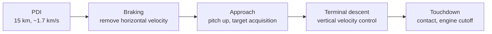

# Orbital mechanics for landing

::: tip Why this matters
A lunar lander does not begin at the surface. It arrives with orbital velocity, and the descent software has to remove it. You do not need the full three-body problem to work on the lander, but you do need to know what state the navigation filter is estimating, why the deorbit burn is cheap and the braking burn is not, and why a 1° plane error costs more than a day of fuel.
:::

## Scope

This page covers the two-body mechanics that a lander FSW/GNC engineer uses:

- conic sections, orbital elements, and the vis-viva equation,
- energy, angular momentum, and plane changes,
- transfer from Earth to lunar orbit at the level needed to read a trajectory product,
- deorbit, braking, and the descent geometry,
- numerical propagation and the state interfaces your software sees.

It deliberately does **not** derive the three-body problem, low-energy transfers, or NRHO station-keeping. Those matter for the transport stage and mission design, not for the descent loop. Know the names, know when to call an astrodynamicist.

## The two-body model

Two point masses with gravitational parameter $\mu = G(M+m)$ obey

$$
\ddot{\mathbf{r}} = -\frac{\mu}{r^3}\mathbf{r},
\qquad r = \lVert \mathbf{r} \rVert .
$$

This is exact only for two point masses. For a lunar lander it is a good first model, with the Moon's oblateness and mascons as perturbations, the Earth and Sun as third-body perturbations, and solar radiation pressure as a small extra acceleration.

The two conserved quantities are specific energy

$$
\varepsilon = \frac{v^2}{2} - \frac{\mu}{r},
$$

and specific angular momentum

$$
\mathbf{h} = \mathbf{r} \times \mathbf{v}.
$$

The sign of $\varepsilon$ determines the conic:

| Energy | Eccentricity | Orbit |
| --- | --- | --- |
| $\varepsilon < 0$ | $e < 1$ | Ellipse (bound) |
| $\varepsilon = 0$ | $e = 1$ | Parabola (escape) |
| $\varepsilon > 0$ | $e > 1$ | Hyperbola (escape with excess speed) |

For a lander, every pre-descent state is an ellipse around the Moon, and the descent turns it into a controlled impact. That is the whole story in one sentence.

## Orbital elements

The classical elements describe the shape and orientation of the conic:

| Element | Symbol | Meaning | Typical LLO value |
| --- | --- | --- | --- |
| Semi-major axis | $a$ | Size | $1{,}837\ \text{km}$ for 100 km circular |
| Eccentricity | $e$ | Shape | $0$ circular, $0.01$–$0.1$ elliptical |
| Inclination | $i$ | Tilt to the reference plane | Mission-dependent, often 90° polar or site-driven |
| Right ascension of ascending node | $\Omega$ | Where the orbit crosses the equator | Sets the ground track |
| Argument of periapsis | $\omega$ | Where periapsis sits in the orbit plane | Sets the low point |
| True anomaly | $\nu$ | Where the vehicle is now | Time-varying |

Two more quantities appear constantly:

$$
r_p = a(1-e), \qquad r_a = a(1+e),
$$

and the period

$$
T = 2\pi\sqrt{\frac{a^3}{\mu}}.
$$

At 100 km circular around the Moon, $a = 1{,}837.4$ km, so

$$
v_c = \sqrt{\frac{4{,}902.8}{1{,}837.4}} \approx 1.633\ \text{km/s},
\qquad
T \approx 118\ \text{min}.
$$

That is the number to remember. Low lunar orbit is fast and the period is short: about two hours, so a missed phasing window comes back quickly, and a plane error does not.

## Vis-viva: the one equation you will use daily

$$
v^2 = \mu\left(\frac{2}{r} - \frac{1}{a}\right).
$$

It gives speed at any radius on a conic. Use it to:

- check an STK or GMAT state vector,
- estimate the cost of a maneuver,
- sanity-check a guidance command,
- compute arrival speed at periapsis before a braking burn.

At the surface, $r = R = 1{,}737.4$ km and $a = R$ for a hypothetical surface-skimming circular orbit:

$$
v_c(R) = \sqrt{\frac{4{,}902.8}{1{,}737.4}} \approx 1.680\ \text{km/s}.
$$

The escape speed is $\sqrt{2}$ times that, about $2.376\ \text{km/s}$. This is why landing is expensive: you must remove roughly 1.7 km/s of horizontal velocity, not just fall gently.

## Maneuvers

### Impulsive versus finite

A **delta-v** is the integral of acceleration over a burn:

$$
\Delta v = \int_{t_0}^{t_f} \frac{T(t)}{m(t)}\,dt .
$$

For a short burn, treat it as instantaneous: the position is unchanged and the velocity jumps. For a descent burn lasting minutes, the finite-burn effect matters. Gravity acts during the burn, and the optimal direction changes. This is why descent guidance is not a single impulse calculation.

### Plane changes

Changing inclination at speed $v$ costs

$$
\Delta v = 2v \sin\left(\frac{\Delta i}{2}\right).
$$

At $v = 1.633$ km/s, a 1° plane change costs about $28.5$ m/s. A 10° change costs about $285$ m/s. Plane changes are cheapest at high altitude where $v$ is low, which is why transfer design does them early and landing does not do them at all if it can avoid it.

**Software implication:** the plane is a targeting constraint. If the arrival orbit plane does not contain the landing site, you either change plane (expensive), wait for the Moon to rotate the site into the plane (cheap but time-consuming), or accept a cross-range requirement in descent (also expensive). The mission design picks one; the descent software inherits the consequence.

### Deorbit

From a 100 km circular orbit, lowering periapsis to 15 km takes only about

$$
\Delta v \approx 19\ \text{m/s}.
$$

That is the cheapest burn in the mission and the one that commits you. Once periapsis is inside the terrain, you must brake. This is why deorbit is a high-consequence command with a go/no-go gate, not a routine throttle tweak.

## Getting to the Moon (the short version)

A full Earth–Moon transfer is a patched-conic or three-body problem. For a lander engineer, the useful facts are:

| Stage | Typical $\Delta v$ | Notes |
| --- | --- | --- |
| LEO to trans-lunar injection (TLI) | ~3.1–3.2 km/s | The big burn; determines arrival geometry |
| Coast to lunar vicinity | ~3 days | Mid-course corrections are tens of m/s |
| Lunar orbit insertion (LOI) | ~0.8–0.9 km/s | Capture into an elliptical orbit |
| Circularization / phasing | ~0.1–0.2 km/s | Depends on arrival orbit |
| Deorbit | ~0.02 km/s | Cheap, commits the descent |
| Powered descent and landing | ~1.9–2.2 km/s | Includes gravity and steering losses |

The numbers are illustrative, not a design. The point is the shape: **most of the energy is spent getting there and stopping, not falling.**

Low-energy transfers and NRHO arrivals change the timing and the capture cost, but they do not change the descent problem. If your mission uses one, the transport team hands you a state vector and a time; your job starts at PDI.

## The descent geometry

A powered descent from low lunar orbit has four jobs:

1. **Remove horizontal velocity** so the vehicle does not overfly the site.
2. **Control vertical velocity** so the vehicle arrives with a survivable sink rate.
3. **Manage altitude and time** so the burn is not cut short or flown too long.
4. **Arrive at the target** with the right position, velocity, attitude, and propellant margin.

A common architecture splits this into phases:



The exact phase boundaries are mission-specific. What matters is that each boundary is a **guard** with a state condition, a time condition, and a fault condition, and that the guidance law changes smoothly enough that the attitude controller can follow.

### The gravity-turn intuition

During braking, the thrust vector is mostly horizontal and slightly upward. Gravity pulls the vehicle down, so the vertical velocity grows unless thrust has an upward component. As horizontal velocity falls, the thrust vector rotates upward. The result is a curved trajectory that looks like a gravity turn, even though there is no atmosphere.

A simplified steering law points the thrust opposite the velocity vector plus a gravity-compensation term:

$$
\hat{\mathbf{u}} = -\frac{\mathbf{v}}{\lVert\mathbf{v}\rVert} + k\,\frac{\mathbf{g}}{\lVert\mathbf{g}\rVert},
$$

normalized, with $k$ chosen so the vertical acceleration keeps the sink rate within limits. This is not an optimal law, but it is a useful mental model and a good first implementation.

### The suicide-burn check

The minimum delta-v to null vertical velocity at altitude $h$ under constant gravity is

$$
\Delta v_{\text{stop}} = \sqrt{2 g h}.
$$

If the available delta-v is less than this, no guidance law can save the vehicle. At $h = 100$ m and $g = 1.62\ \text{m/s}^2$, that is only $18\ \text{m/s}$ — which is why the terminal phase is survivable with a small reserve, and why arriving fast at low altitude is so dangerous. At $h = 1{,}000$ m, it is $57\ \text{m/s}$. Compare that with the cost of hovering: every second at hover throttle costs $g$ in delta-v, about $1.62\ \text{m/s}$ per second.

**Rule of thumb:** hovering is a luxury. A 30-second hover costs about 49 m/s, which is often more than the entire terminal reserve.

## Targeting a surface point

The landing site is fixed to the rotating Moon. In the Moon-fixed frame, the vehicle has a Coriolis and centrifugal contribution:

$$
\mathbf{a}_{\text{fixed}} = \mathbf{a}_{\text{inertial}} - 2\boldsymbol{\omega}\times\mathbf{v}_{\text{fixed}} - \boldsymbol{\omega}\times(\boldsymbol{\omega}\times\mathbf{r}).
$$

At the Moon's rotation rate the centrifugal term is small (about $0.01\ \text{m/s}^2$ at the equator) but not zero, and the Coriolis term at 100 m/s is about $5\times10^{-4}\ \text{m/s}^2$. Over a 600 s descent, that is a few tenths of a metre per second — small, but the kind of small that shows up in a precision-landing error budget.

The practical approach:

- **Navigate in an inertial frame** (or a well-defined Moon-centred inertial frame).
- **Define the target in a body-fixed frame** and transform it at the current epoch.
- **Compute the relative state** in the frame the guidance law uses, and be explicit about which frame that is.
- **Model the rotation** if the mission requires metre-level targeting; ignore it only when the error budget says you can.

This is the same frame discipline as the [frames & time lesson](../gnc/frames-time.md), applied to a moving target.

## Numerical propagation

Flight software rarely integrates a full gravity model at high rate. It uses a simple, deterministic propagator between navigation updates. The design questions are:

- **Which frame?** Inertial for dynamics; body-fixed for targeting.
- **Which integrator?** Fixed-step RK4 is common offline; flight code may use a lower-order method at a fixed rate with a known error bound.
- **Which step size?** Small enough that the error over the coast is inside the budget, large enough to fit the CPU.
- **What is the forcing?** Thrust, gravity, and possibly drag (none on the Moon).
- **How is it tested?** Against a high-fidelity reference, with a convergence study and a timing test.

A minimal RK4 step for $\dot{\mathbf{x}} = f(\mathbf{x}, t)$:

```cpp
// Fixed-size state: position, velocity, mass.
struct State { double r[3]; double v[3]; double m; };

State rk4(const State& x, double dt, const AccelFn& accel) {
  const State k1 = deriv(x, accel);
  const State k2 = deriv(add(x, k1, dt / 2), accel);
  const State k3 = deriv(add(x, k2, dt / 2), accel);
  const State k4 = deriv(add(x, k3, dt), accel);
  return add(x, combine(k1, k2, k3, k4, dt), 1.0);
}
```

In real flight code you would not allocate, would not use a generic callback with unknown timing, and would fix the loop bounds. The pattern is still RK4.

### A propagation sanity test

Propagate a circular orbit for one period. The position and velocity should return to the start. If they do not, either the step size is too large, the integrator is wrong, or the frame is rotating when you think it is inertial. This test catches more bugs than any amount of code review.

For a 100 km circular orbit, $T \approx 7{,}080$ s. With a 1 s step, that is 7,080 steps; with RK4 the error should be tiny. Compare against the analytic solution:

$$
\mathbf{r}(t) = \mathbf{r}_0\cos(nt) + \frac{\mathbf{v}_0}{n}\sin(nt),
\qquad n = \sqrt{\frac{\mu}{a^3}}.
$$

If your propagator cannot reproduce a circle, do not trust it with a descent.

## What the flight software actually receives

The descent software does not solve the two-body problem from scratch. It receives:

| Input | Frame | Typical source |
| --- | --- | --- |
| Position and velocity | Moon-centred inertial | Navigation filter |
| Attitude and body rates | Body relative to inertial | Navigation filter |
| Mass and inertia | Body | Mass model, propellant gauging |
| Target position | Body-fixed | Mission plan, DEM |
| Time | TAI/UTC/SCLK | Time service |
| Thruster model | Body | Propulsion calibration |
| Gravity model | Inertial | Constants table |

The interface is where most integration bugs live. Two teams can agree on "position" and still disagree on centre, frame, epoch, and units. Write the contract down, with a unit and a frame for every field, and test it with a known vector.

## Worked example: is this descent feasible?

Suppose the vehicle is in a 100 km circular orbit with a landing site 20° ahead in the orbit plane. It performs a 19 m/s deorbit to a 15 km periapsis, then begins powered descent at 15 km with about 1.69 km/s of inertial velocity.

Available descent delta-v: 2,050 m/s. Required:

| Item | Estimate |
| --- | --- |
| Cancel inertial velocity at 15 km | 1,690 m/s |
| Gravity loss during braking (rough) | 250 m/s |
| Steering and control losses | 60 m/s |
| Terminal descent and hover allowance | 80 m/s |
| **Total** | **2,080 m/s** |

The budget is short by 30 m/s before reserves. The correct conclusion is not "tune the guidance." It is that the descent profile, the deorbit geometry, or the propellant load has to change. A 30 m/s shortfall at PDI is a mission-level problem, and the earlier you can compute it, the cheaper the fix.

::: tip Flight-software lens
Put this calculation in a unit test. Given a state, a mass, a thrust model, and a target, assert that the required delta-v is below the available delta-v with margin. That test is a requirement check, an analysis tool, and a regression guard all at once.
:::

## Common mistakes

- **Mixing frames.** A state labelled "inertial" that is actually Moon-fixed will produce a plausible but wrong descent.
- **Forgetting the Moon rotates.** For metre-level targeting, the site moves.
- **Using constant gravity.** It is fine for a controller, not for a 10-minute propagation.
- **Treating a finite burn as an impulse.** Gravity losses are real.
- **Ignoring plane geometry.** A descent cannot fix a large cross-range error cheaply.
- **Trusting a propagator that has never been tested on a circle.**
- **Reporting delta-v without a mass assumption.** Delta-v is only meaningful with a mass and an $I_{sp}$.

## Practice

1. **Vis-viva drill.** Compute circular speed and period at 50 km, 100 km, and 200 km lunar altitude. Then compute the speed at periapsis of an orbit with $r_p = 1{,}752$ km and $r_a = 1{,}937$ km. Check your answers with a single Python script.
2. **Plane-change cost.** Plot $\Delta v$ versus $\Delta i$ for 0–30° at 100 km. At what inclination change does the cost exceed the entire terminal descent reserve?
3. **Circular-orbit test.** Implement RK4 for the two-body problem. Propagate one period at 10 s, 1 s, and 0.1 s steps. Plot the final position error. Explain the convergence order.
4. **Descent budget.** Build a spreadsheet or script that takes $h_{\text{PDI}}$, $v_{\text{PDI}}$, $m_0$, $I_{sp}$, and thrust, and estimates the delta-v to land. Add a 10% reserve. Find the point where the budget becomes infeasible.
5. **Targeting frame.** Place a target at 20°S, 30°E in a Moon-fixed frame. Transform it to an inertial frame at two epochs one hour apart. How far does it move? Does that matter for your landing accuracy requirement?

<Quiz
  question="Why is a plane change cheaper in a high, slow orbit than in a low, fast one?"
  options="Because gravity is weaker at high altitude|Because the required delta-v is proportional to orbital speed, so a slower orbit needs less velocity change for the same angle|Because high orbits have no mascons|Because the Moon rotates faster at high altitude"
  answer="1"
  explanation="For an impulsive plane change, Δv = 2v sin(Δi/2). The angle is the same, but v is smaller at higher altitude, so the cost is lower. This is why plane changes are done early in a transfer rather than during descent."
/>

<Quiz
  question="A lander arrives at 15 km altitude with 1.7 km/s of horizontal velocity and 2.0 km/s of available descent delta-v. What is the main risk?"
  options="The vehicle will not be able to point its engine|The descent budget is tight once gravity and steering losses are included, leaving little margin for terminal descent or contingencies|The navigation filter cannot operate at 15 km|The vehicle will re-enter the atmosphere"
  answer="1"
  explanation="Cancelling 1.7 km/s is only part of the cost. Gravity losses during a multi-minute braking burn, steering losses, and the terminal descent reserve all consume delta-v. A 2.0 km/s budget leaves little room, so the profile and reserves must be analyzed before PDI."
/>

## Resources

- [Vallado, *Fundamentals of Astrodynamics and Applications*](https://www.springer.com/gp/book/9781881883142) — the standard reference for two-body mechanics and frames.
- [NASA GMAT](https://gmat.sourceforge.net/) — free trajectory design and propagation tool.
- [STK](https://www.ansys.com/products/missions/ansys-stk) — high-fidelity mission analysis; use it to check your hand calculations.
- [NASA LRO/LOLA topography](https://lunar.gsfc.nasa.gov/) — terrain and gravity data for targeting.
- [Apollo 11 Lunar Module Descent](https://www.nasa.gov/history/alsj/a11/a11.1201-pdi.html) — the original powered descent, with timeline and commentary.

Next: [bridge to the LLV PDI console](./llv-bridge.md) or [frames, time & transformations](../gnc/frames-time.md).
